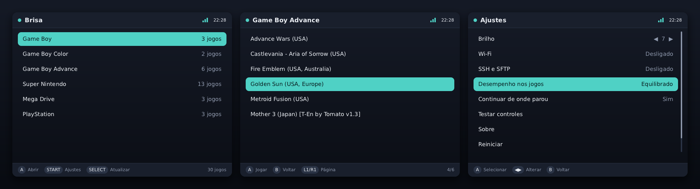
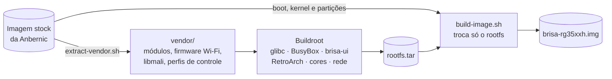

<p align="center">
  
</p>

<p align="center">
  <a href="LICENSE"></a>
  
  
  
  
</p>

<p align="center">
  <b>Liga rápido, fica fora do caminho e deixa o jogo começar.</b><br>
  Um firmware enxuto, com interface própria, para o portátil Anbernic RG35XX H.
</p>

<p align="center">
  <a href="#-começando">Começando</a> ·
  <a href="#-como-funciona">Como funciona</a> ·
  <a href="#-uso">Uso</a> ·
  <a href="#-desenvolvimento">Desenvolvimento</a> ·
  <a href="#-roadmap">Roadmap</a>
</p>

<p align="center">
  
</p>

## ✨ Destaques

| | |
|---|---|
| ⚡ **Boot rápido** | BusyBox init e um `rcS` mínimo: monta o cartão e abre a interface. Rede, udev e áudio sobem em segundo plano. |
| 🎨 **Interface própria** | Escrita em C, desenhada direto no framebuffer, sem depender da GPU. Navegação com repetição de teclas, recentes, ajustes e teste de controles. |
| 🎮 **Emulação ajustada** | RetroArch para Mali-G31 (fbdev), cores escolhidos para o H700, governor da CPU por sistema, run-ahead nos sistemas leves e "continuar de onde parou". |
| 📶 **Rede sem complicação** | Wi-Fi configurado por um arquivo no cartão, SSH e SFTP com um toque, relógio acertado via NTP. |
| 🪶 **Leve** | Rootfs de ~52 MB. A interface depende só da libc. |
| 🛟 **Sem risco** | O aparelho inicia pelo microSD. Não gostou? Troque o cartão. |

## 🚦 Status

O Brisa está em **alpha**. Já funciona e foi testado:

Testado no **RG35XX H** real:

- ✅ Boot com o logo do Brisa; rootfs montado em ~1,8 s
- ✅ Interface, controles, cartão de jogos (FAT32) e pastas no padrão da Anbernic
- ✅ Jogos de Game Boy, Game Boy Color e SNES com imagem (GPU Mali-G31) e som
- ✅ Saída do jogo pelo POWER e desligamento limpo segurando POWER por 2 s

Também:

- ✅ Build completo: interface, RetroArch 1.22 com GPU Mali (fbdev) e os 6 cores
- ✅ Extração do firmware stock **V1.2.4** da Anbernic: kernel 4.9.170, driver da GPU, Wi-Fi 8821cs e 391 perfis de controle
- ✅ Interface no PC, com testes automáticos que geram capturas de tela

Ainda não testado no aparelho: Wi-Fi/SSH, segundo cartão (TF2), Mega Drive e PlayStation.

## 🚀 Começando

### Requisitos

- Linux ou **WSL2** (Ubuntu 22.04 ou mais novo), com ~40 GB livres durante o primeiro build
  (depois do `make clean-stock`, ficam ~10 GB)
- A **imagem do firmware stock** do RG35XX H (site da Anbernic, ou uma cópia do seu cartão original)
- Um cartão microSD

### Compilar

```bash
git clone https://github.com/MatheusSenra/brisa-os.git
cd brisa-os
make deps
```

Extraia do firmware stock o que o Brisa reaproveita (kernel, módulos, driver da GPU):

```bash
make vendor STOCK=/caminho/para/RG35XXH-stock.img.7z
```

Confira o relatório, depois compile. A primeira compilação leva cerca de uma hora.

```bash
cat vendor/info/report.txt
```

```bash
make
```

Antes de montar a imagem, o `make` roda o `make check`: confere se o RetroArch tem o contexto de vídeo da Mali, se toda biblioteca que os binários pedem está no sistema e se os módulos do stock estão no lugar.

O resultado fica em **`out/brisa-rg35xxh.img.xz`** (~2,5 GB).

### Gravar

Grave o `.img.xz` direto no cartão (não precisa descompactar) com o [balenaEtcher](https://etcher.balena.io/) ou o [Rufus](https://rufus.ie/), coloque no slot **TF1** e ligue.

No **primeiro boot**, se o cartão for maior que a imagem (~15 GB), o Brisa cria com o espaço que sobra uma partição **exFAT chamada BRISA** e move para ela os jogos que você já tiver colocado. A tela mostra "Preparando o cartão…" enquanto isso acontece, uma vez só. Depois, no Windows, é na unidade **BRISA** que ficam os jogos (`Roms/`) e os saves (`Brisa/`).

> [!TIP]
> Use `make IMAGE_OPTS="--xz --wipe-storage"` para também formatar a partição de dados do cartão como FAT32.

## 🧭 Como funciona

O Brisa **mantém o bootloader e o kernel 4.9 da Anbernic** e troca só o sistema de arquivos, o mesmo caminho do muOS. Tela, áudio, botões e Wi-Fi funcionam com os drivers originais, e o resto é nosso.



**Na inicialização**, o `rcS` monta o cartão (o TF2 tem prioridade para as ROMs, se existir) e grava os caminhos em `/run/brisa/env`. Em seguida o init abre a `brisa-ui`. Ao escolher um jogo, a interface solta a tela e chama o `brisa-launch`, que ajusta a CPU e abre o RetroArch com a configuração do sistema. Enquanto o jogo roda, a interface continua ouvindo os atalhos globais: volume, brilho e POWER.

## 🎮 Uso

### Sistemas

| Sistema | Pasta em `Roms/` | Core | Extensões |
|---|---|---|---|
| Game Boy | `GB` | Gambatte | `.gb` `.zip` |
| Game Boy Color | `GBC` | Gambatte | `.gbc` `.gb` `.zip` |
| Game Boy Advance | `GBA` | mGBA | `.gba` `.zip` |
| Nintendo (NES) | `NES`, `FC` | FCEUmm | `.nes` `.fds` `.unf` `.zip` |
| Super Nintendo | `SNES`, `SFC` | Snes9x | `.sfc` `.smc` `.zip` |
| Master System | `MS`, `SMS` | PicoDrive | `.sms` `.zip` |
| Game Gear | `GG` | PicoDrive | `.gg` `.zip` |
| Mega Drive | `MD`, `Genesis` | PicoDrive | `.md` `.gen` `.smd` `.bin` `.zip` |
| Mega CD | `SEGACD`, `MegaCD` | PicoDrive | `.cue` `.chd` |
| Sega 32X | `32X` | PicoDrive | `.32x` `.zip` |
| PlayStation | `PS`, `PS1`, `PSX` | PCSX ReARMed | `.cue` `.chd` `.pbp` `.m3u` |

Para adicionar um sistema, basta uma linha em [`systems.conf`](buildroot/board/rg35xxh/rootfs-overlay/etc/brisa/systems.conf).

### Cartão

No primeiro boot, o Brisa cria a estrutura de pastas:

```text
Roms/GB  Roms/GBA  Roms/SNES  Roms/PS  ...   ← seus jogos
Brisa/bios                                   ← BIOS (ex.: scph5501.bin para PS1)
Brisa/saves   Brisa/states                   ← saves e estados salvos
Brisa/wifi.conf.exemplo                      ← copie como wifi.conf
```

### Botões

| Botão | Ação |
|---|---|
| **START** (na lista) | Ajustes |
| **SELECT** (na lista) | Atualiza a lista de jogos |
| **MENU** + ↑/↓ | Brilho (funciona também no jogo) |
| **MENU** + **START** (no jogo) | Sai do jogo (padrão da Anbernic) |
| Segurar **START** 2 s (no jogo) | Menu do RetroArch (padrão da Anbernic) |
| **POWER** (toque) | Menu de energia; no jogo, sai salvando |
| **POWER** (2 s) | Desliga com segurança. Não segure mais: o hardware corta a energia e pode corromper o cartão |
| **Volume** | Funciona na interface e no jogo |

### Rede

Crie `Brisa/wifi.conf` no cartão:

```ini
REDE=Nome da minha rede
SENHA=minha senha
```

Depois ligue o Wi-Fi em **Ajustes**. Com **SSH e SFTP** ligado, conecte como `root` (senha `brisa`) e troque a senha com `passwd`.

## 🛠 Desenvolvimento

### Estrutura

```text
brisa-os/
├── ui/                        interface (C, framebuffer + evdev; SDL2 no PC)
├── buildroot/                 árvore externa do Buildroot
│   ├── configs/               brisa_rg35xxh_defconfig
│   ├── package/               brisa-ui, brisa-mali, brisa-retroarch, cores libretro...
│   └── board/rg35xxh/         rootfs-overlay (rcS, scripts brisa-*, configs)
├── scripts/                   extração do stock, montagem da imagem, testes
└── docs/                      imagens deste README
```

### Interface no PC

```bash
make ui-run
```

| Tecla | Botão | Tecla | Botão |
|---|---|---|---|
| Setas | Direcional | Enter | START |
| X | A | Shift direito | SELECT |
| Z | B | Esc | MENU |
| Q / W | L1 / R1 | P | POWER |

### Testes

```bash
make test
```

O comando roda a interface sem janela, seguindo um roteiro que salva capturas em `ui/build/shots/`. Depois executa a extração e a montagem de imagem com um firmware stock falso.

### Espaço em disco

O build fica fora do projeto, em `~/brisa-work` (no WSL). Para liberar espaço:

| Comando | Apaga | Depois |
|---|---|---|
| `make clean-stock` | cópias de trabalho do firmware stock (~14 GB) | nada a refazer: o que importa já está em `vendor/` |
| `make clean` | o build do Buildroot (~9 GB) | o próximo `make` recompila tudo (~1 h) |
| `make distclean` | os dois acima e a imagem | idem |

> [!NOTE]
> No WSL, apagar arquivos não devolve espaço ao Windows sozinho. Rode `wsl --manage Ubuntu --set-sparse true` uma vez e, depois de limpar, `wsl -u root fstrim -v /` seguido de `wsl --shutdown`.

### Sem o firmware stock

Dá para compilar e validar todo o sistema, exceto o RetroArch:

```bash
make config-nogpu rootfs
```

### Atualizar só a interface no aparelho

```bash
make rebuild-ui
```

```bash
scp ~/brisa-work/output/target/usr/bin/brisa-ui root@<ip-do-aparelho>:/usr/bin/
```

## 🗺 Roadmap

O plano completo, com o estudo do muOS e do KNULLI, o comparativo de recursos e os diferenciais do Brisa, está em **[docs/ROADMAP.md](docs/ROADMAP.md)**.

| Fase | Foco | Destaques |
|---|---|---|
| **0. Fundamentos** ✳️ | Base confiável | Cartão inteiro, volume, reparo automático do cartão, bateria crítica |
| **1. Experiência essencial** | Uso diário | **Quick Resume**, ociosidade, Wi-Fi na tela, busca, favoritos, atualização sem regravar |
| **2. Biblioteca bonita** | Visual | Capas, tempo de jogo, temas leves, ajustes por jogo |
| **3. Mais sistemas** | Conteúdo | Arcade (FBNeo), Atari, WonderSwan, PC Engine, depois PSP, N64, Dreamcast |
| **4. Rede e nuvem** | Conectividade | **Painel Brisa** no navegador, sincronização de saves, RetroAchievements |
| **5. Hardware** | Alcance | HDMI, Bluetooth, outros aparelhos H700, kernel mainline |

## 🤝 Contribuindo

Issues e pull requests são bem-vindos. Antes de abrir um PR, rode `make test`.
Se você tem um RG35XX H, o mais útil agora é testar no aparelho e contar o que aconteceu: tela, botões, áudio e Wi-Fi.

## 📄 Licença e avisos

O código deste repositório está sob a licença [MIT](LICENSE).
O RetroArch e os cores são baixados durante a compilação e mantêm suas próprias licenças (GPL e outras).

O Brisa OS **não** é afiliado à Anbernic. Este repositório não contém nem distribui ROMs, BIOS ou arquivos proprietários do firmware stock: eles são extraídos localmente, da sua própria cópia, pelo `make vendor`.
